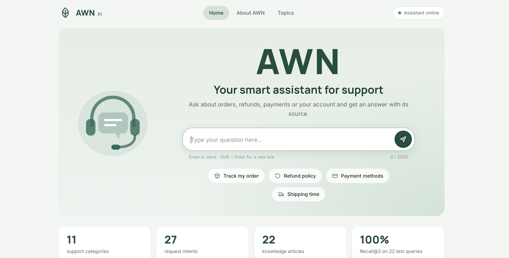
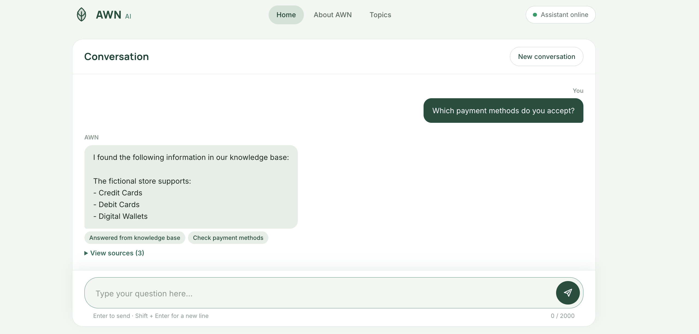

# AWN AI (عَون)

### ذكاء يفهم طلبك، ويوصلك للحل.

AWN AI (عَون) is an educational portfolio project for customer-support intelligence. It classifies an incoming message, decides whether that message is in scope, and retrieves passages from a static knowledge base for a fictional store.

The running application does not place orders, process payments, or generate replies with a connected language model.

---

## Screenshots

### Homepage



### Chat response



---

## Project Overview

Customer messages may be relevant to the store, unrelated, or too unclear to answer. AWN AI checks scope before it searches the knowledge base.

### What the application does

- **Scope detection** labels a message as `IN_SCOPE`, `OUT_OF_SCOPE`, or `UNCLEAR_SCOPE`.
- **Category and intent classification** run only after a message is labeled `IN_SCOPE`. They are separate models from scope detection.
- **Hybrid retrieval** ranks knowledge-base chunks with a weighted mix of the original query and an intent-enriched query.
- **REST API** serves the web interface, a health check, and message processing.
- **Web interface** accepts a message, starts a new conversation, and shows a typing indicator while a request is in progress.
- **Source excerpts** are returned with the retrieved chunks for in-scope messages.

---

## System Workflow

1. A message is submitted through the web interface.
2. `POST /api/chat` receives the message.
3. Scope Detection V3 assigns `IN_SCOPE`, `OUT_OF_SCOPE`, or `UNCLEAR_SCOPE`.
4. `OUT_OF_SCOPE` and `UNCLEAR_SCOPE` stop there and return a predefined response. Category, intent, and retrieval are not used.
5. An `IN_SCOPE` message is passed to the category model and then the intent model.
6. Hybrid retrieval searches the knowledge base with the original message and the predicted intent, and keeps up to three chunks with a positive score.
7. The API response quotes the top retrieved chunk, or a predefined fallback when nothing is retrieved. The matching chunks are returned as sources.

`src/pipeline.py` and `src/response_generator.py` can accept a callable for language-model generation. That path is not connected to the API.

---

## Scope Detection V3

Scope Detection V3 is the main model evaluation in this project. It is a scope task only. It does not predict category or intent.

The dataset is manually authored and synthetic: `data/processed/scope_detection_v3.csv`.

| Property | Value |
|---|---:|
| Total messages | 600 |
| Scope classes | 3, balanced |
| Messages per class | 200 |
| Writing styles | 5 |
| Message patterns | 15 |
| Dataset quality checks | 15/15 passed |

Classes:

- `IN_SCOPE`
- `OUT_OF_SCOPE`
- `UNCLEAR_SCOPE`

### Evaluation

Both candidate models used the same **5-fold `StratifiedGroupKFold`**, grouped by `pattern`, so the same pattern does not appear in both the training and evaluation portions of a fold. Each fold trains on 480 messages and evaluates on 120.

Mean fold Macro F1 was the selection metric. The figure below is the mean of the five fold scores. It is not an out-of-fold aggregate.

| Model | Mean fold Macro F1 |
|---|---:|
| V1: Word TF-IDF + Logistic Regression | 0.804 |
| V2: Word + Character TF-IDF + LinearSVC | **0.853** |

V2 scored higher in all five folds and was saved as `models/scope_detection_v3.joblib`. The artifact was then trained on all 600 messages. Scores from that full-data fit are not an independent evaluation.

Recorded fold means before rounding are 0.803732 (V1) and 0.852994 (V2).

### V2 class scores from that evaluation

| Class | F1 |
|---|---:|
| IN_SCOPE | 0.824 |
| OUT_OF_SCOPE | 0.905 |
| UNCLEAR_SCOPE | 0.835 |

Reported IN_SCOPE recall for this evaluation is 0.770. LinearSVC margins are not probabilities. These scores describe the synthetic grouped cross-validation. They are not a production-performance claim.

---

## Category and Intent Classification

Category and intent are separate from Scope Detection V3. They run only when scope is `IN_SCOPE`. Otherwise both values are `None`.

| Task | Artifact | Role |
|---|---|---|
| Category | `models/lumora_model_v2.joblib` | Loaded by `src/predictor.py` |
| Intent | `models/lumora_intent_model_v2.joblib` | Loaded by `src/intelligence.py` |

Both selected artifacts use character TF-IDF with LinearSVC. The earlier customer-message file, `data/raw/customer_support_tickets.csv`, has 11 categories and 27 intents. Those label sets are not the three scope classes, and this README does not treat their earlier accuracy figures as the project result.

---

## Hybrid Knowledge Retrieval

Retrieval is a separate component from scope detection. For an in-scope message, `src/retriever.py`:

1. Builds one TF-IDF matrix over the knowledge chunks (word unigrams and bigrams, cosine similarity).
2. Scores each chunk against the original message.
3. Scores each chunk again against the message plus fixed search terms for the predicted intent, when that intent is known.
4. Combines the scores as **75% original-query similarity** and **25% intent-enriched similarity**.
5. Returns up to three chunks whose combined score is greater than zero.

The chat API asks for `top_k=3` and uses the first returned chunk as the reply text.

### Retrieval benchmark

This benchmark is not the Scope Detection V3 result. It uses 22 authored queries.

| Metric | Result |
|---|---:|
| Precision@1 | 81.82% |
| Recall@3 | 100% |
| Mean Reciprocal Rank (MRR) | 90.91% |

On that query set, 18 of 22 expected chunks were at rank 1. The other four were at rank 2, so every expected chunk appeared in the top three. These figures describe that authored set only.

---

## Knowledge Base

The knowledge base is `docs/knowledge_base.md`. The loader splits it into **22 chunks** for **Lumora Demo Store**, a fictional demonstration store.

The chunks cover store overview, orders, shipping and delivery, refunds and returns, payments, customer accounts, newsletter subscriptions, customer support, and assistant guidelines.

Policies in those chunks are demonstration text. They are not live store commitments, and the application cannot look up a real order, payment, or refund.

---

## Technology Stack

| Area | Technologies |
|---|---|
| Programming language | Python 3.12 |
| Data analysis | pandas, NumPy |
| Machine learning | scikit-learn |
| Model persistence | joblib |
| Backend API | FastAPI |
| ASGI server | Uvicorn |
| Frontend | HTML, CSS, JavaScript |
| Testing | pytest |
| Notebooks | JupyterLab |

Versions are pinned in `requirements.txt`.

---

## Project Structure

The product name is AWN AI (عَون). Some local paths and model filenames still use the earlier Lumora name.

```text
├── data/
│   ├── raw/
│   ├── processed/
│   └── benchmark/
├── docs/
│   ├── PROJECT_STATE.md
│   ├── WORK_LOG.md
│   ├── knowledge_base.md
│   ├── annotation_guidelines.md
│   ├── benchmark_specification.md
│   ├── benchmark_release_manifest.txt
│   └── screenshots/
│       ├── homepage.png
│       └── chat-response.png
├── models/
│   ├── scope_detection_v3.joblib
│   ├── lumora_model_v2.joblib
│   └── lumora_intent_model_v2.joblib
├── notebooks/
├── src/
│   ├── api.py
│   ├── intelligence.py
│   ├── knowledge_base.py
│   ├── pipeline.py
│   ├── predictor.py
│   ├── response_generator.py
│   ├── retriever.py
│   └── static/
│       ├── index.html
│       ├── style.css
│       └── app.js
├── tests/
├── requirements.txt
└── README.md
```

`models/` also contains earlier experiment artifacts. The three files above are the ones the application loads.

---

## Getting Started

### Prerequisites

- Python 3.12
- pip
- Git

### 1. Clone the repository

```text
git clone YOUR-GITHUB-REPOSITORY-URL
cd YOUR-REPOSITORY-DIRECTORY
```

### 2. Create a virtual environment

```text
python3 -m venv .venv
```

### 3. Activate the environment

**macOS / Linux**

```text
source .venv/bin/activate
```

**Windows**

```text
.venv\Scripts\activate
```

### 4. Install dependencies

```text
python -m pip install --upgrade pip
pip install -r requirements.txt
```

### 5. Run the application

From the project root:

```text
uvicorn src.api:app --reload
```

Open:

```text
http://127.0.0.1:8000
```

---

## API Endpoints

| Endpoint | Method | Description |
|---|---|---|
| `/` | GET | Serves the web interface |
| `/static` | GET | Serves static assets |
| `/health` | GET | Returns `{"status": "healthy"}` |
| `/api/chat` | POST | Processes one customer message |

`POST /api/chat` expects JSON `{"message": "..."}` (1–2000 characters). The response includes `scope`, `category`, `intent`, `response`, and `sources`.

---

## Running Tests

From the project root:

```text
pytest -q
```

The suite currently defines **49 tests** across the API, scope and intent analysis, category predictor, retriever, pipeline, and response-generator modules. A previously recorded run reported **49 passing tests**. This README does not add a new test result.

---

## Limitations

- AWN AI (عَون) is an educational portfolio project, not a production support service.
- No live order or payment integration is connected. The system cannot confirm order status, cancel an order, or execute a refund.
- No LLM-based response generation is currently connected. The chat API returns a retrieved knowledge excerpt or a predefined scope or fallback response.
- The knowledge base is 22 static chunks for the fictional Lumora Demo Store.
- Retrieved excerpts and predefined replies are in English.
- Scope Detection V3 was measured on synthetic messages with grouped cross-validation. That result does not establish performance on real customer traffic.
- Category and intent checks used datasets with known exposure limits. They are not reported here as the main evaluation.

---

## Documentation

Further notes in `docs/` include project state, the work log, the knowledge base, annotation guidelines, the Scope Detection V3 benchmark specification, and benchmark release manifests.

---

## Project Status

Classification, hybrid retrieval, the API, and the web interface are integrated for local demonstration. Remaining work is documentation and demonstration preparation. No deployed public URL is part of this project.

---

## Disclaimer

AWN AI (عَون) demonstrates applied text classification, information retrieval, and a small web API. It is not a production customer-support platform.

**AWN AI (عَون)**  
*ذكاء يفهم طلبك، ويوصلك للحل.*
